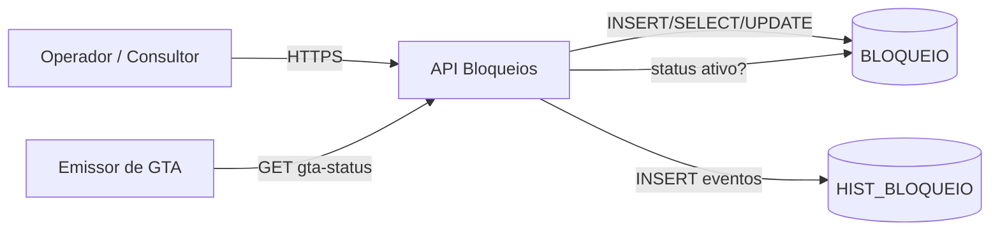

# Arquitetura — Bloqueios Sanitários

> **Derivado de:** specs/DATA_MODEL.md (BLOQUEIO, HIST_BLOQUEIO), REQUIREMENTS.md §2 (atores), DECISIONS.md (DEC-001)

---

## 1. Decisões Arquiteturais

| # | Decisão | Justificativa | Origem |
|---|---|---|---|
| ADR-001 | API REST monolito modular | Volume baixo (CRUD + consulta), sem necessidade de microsserviços | DATA_MODEL (2 tabelas) |
| ADR-002 | Histórico unificado em HIST_BLOQUEIO com TIP_EVENTO | DEC-001 — consulta histórica unificada | DECISIONS.md |
| ADR-003 | Status de GTA exposto via endpoint de consulta (pull) | Emissor de GTA consulta sob demanda (RN-003), sem acoplamento push | REQUIREMENTS §8 |

## 2. Stack

| Camada | Escolha | Observação |
|---|---|---|
| API | REST (JSON) | Contratos em API_CONTRACTS.md |
| Persistência | Banco relacional (sequence PK) | DATA_MODEL.md — NUMBER/VARCHAR2/DATE |
| Auditoria | Colunas CTR_* em toda tabela | Convenção §9 de REQUIREMENTS.md |

## 3. Diagrama de Arquitetura

## 4. Módulos

| Módulo | Responsabilidade | Endpoints |
|---|---|---|
| Bloqueios | Ciclo de vida do bloqueio (criar, encerrar) | POST /bloqueios, POST /bloqueios/{id}/encerramento |
| Consulta | Listagem e filtros | GET /bloqueios |
| GTA Status | Exposição de status para o emissor | GET /bloqueios/gta-status/{idProdutor} |
| Histórico | Registro de eventos (criado, encerrado) | (interno — via HIST_BLOQUEIO) |

## 5. Fluxo de Dados

1. Operador aplica bloqueio → API valida duplicidade (SELECT BLOQUEIO ativo)
   → INSERT BLOQUEIO + INSERT HIST_BLOQUEIO (CRIADO) — RN-001, RN-002
2. Emissor de GTA consulta status → SELECT BLOQUEIO ativo → impede/libera — RN-003
3. Operador encerra → UPDATE BLOQUEIO (status, motivo fim) + INSERT
   HIST_BLOQUEIO (ENCERRADO) — RN-004

## 6. Padrões

- DTOs por contrato (API_CONTRACTS.md), sem expor entidades
- Repository para acesso a BLOQUEIO/HIST_BLOQUEIO
- Erros de negócio mapeados para códigos do ERROR_CATALOG.md
