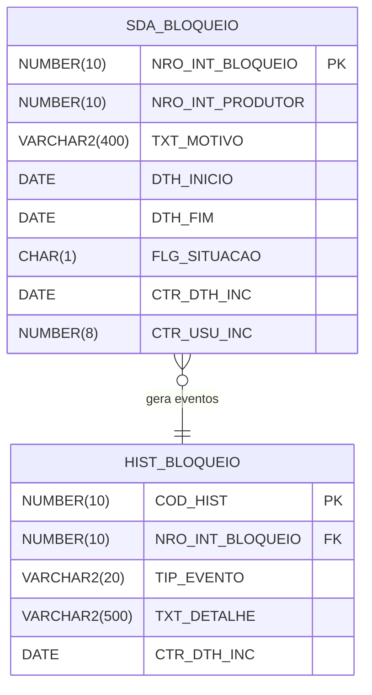

# Modelo de Dados — Bloqueios Sanitários (reuso do legado)

> **Derivado de:** LEGACY_CONTEXT.md (SDA_BLOQUEIO), REQUIREMENTS.md (RN-001, RN-002, RN-003, RN-004)
> **Última atualização:** 21/09/2026

---

## 1. Diagrama Entidade-Relacionamento

---

## 2. Tabelas

### 2.1 SDA_BLOQUEIO (tabela legada reaproveitada)

Tabela **existente em produção**, reaproveitada pelo novo módulo. Todas as
colunas legadas são preservadas; as não usadas pelo módulo estão marcadas
com "(não usado)". Tipos e nomes originais mantidos — **sem renomeação**.

**Identificação:** PK via sequence legada (nominal `SEQ_SDA_BLOQUEIO`)

| Coluna | Tipo | Obrigatório | PK/FK | Descrição |
|---|---|---|---|---|
| NRO_INT_BLOQUEIO | NUMBER(10) | Sim | PK | ID do bloqueio (sequence legada) |
| NRO_INT_PRODUTOR | NUMBER(10) | Sim | — | Produtor bloqueado |
| TXT_MOTIVO | VARCHAR2(400) | Não | — | Motivo do bloqueio (legado: 400) |
| DTH_INICIO | DATE | Sim | — | Início do bloqueio |
| DTH_FIM | DATE | Não | — | Fim (encerramento ou expiração) |
| FLG_SITUACAO | CHAR(1) | Sim | — | `A` = ativo, `E` = encerrado (inclui expirado) |
| CTR_DTH_INC | DATE | Sim | — | Auditoria |
| CTR_USU_INC | NUMBER(8) | Sim | — | Auditoria |

**Check constraints (legado, preservadas):**
- `CK_FLG_SIT: FLG_SITUACAO IN ('A', 'E')`

**Índices (legado, preservados):**
- `IDX_BLOQ_PRODUTOR` (NRO_INT_PRODUTOR)

**Uso no módulo — colunas preenchidas:**

| Coluna | Valor | Origem |
|---|---|---|
| NRO_INT_BLOQUEIO | SEQ_SDA_BLOQUEIO | PK |
| NRO_INT_PRODUTOR | Do request | Request |
| TXT_MOTIVO | Do request (motivo) | Request |
| DTH_INICIO | Data/hora da aplicação (RN-001) | Sistema |
| DTH_FIM | Data do encerramento/expiração (RN-004, RN-003) | Sistema |
| FLG_SITUACAO | 'A' na criação; 'E' no encerramento/expiração | Regra |
| CTR_* | Auditoria padrão | Regra |

### 2.2 HIST_BLOQUEIO (tabela nova)

Histórico de eventos do novo módulo (DEC-001): eventos `CRIADO`,
`ENCERRADO` e `EXPIRADO` (RN-003), vinculados por NRO_INT_BLOQUEIO.

| Coluna | Tipo | Obrigatório | PK/FK | Descrição |
|---|---|---|---|---|
| COD_HIST | NUMBER(10) | Sim | PK | ID do evento (SEQ_HIST_BLOQUEIO) |
| NRO_INT_BLOQUEIO | NUMBER(10) | Sim | FK → SDA_BLOQUEIO | Bloqueio referenciado |
| TIP_EVENTO | VARCHAR2(20) | Sim | — | `CRIADO`, `ENCERRADO` ou `EXPIRADO` |
| TXT_DETALHE | VARCHAR2(500) | Não | — | Detalhe (motivo do fim, etc.) |
| CTR_DTH_INC | DATE | Sim | — | Auditoria |
| CTR_USU_INC | NUMBER(8) | Sim | — | Auditoria |

**Check constraints:**
- `TIP_EVENTO IN ('CRIADO', 'ENCERRADO', 'EXPIRADO')`

---

## 3. Decisão de armazenamento

| Opção | Status | Motivo |
|---|---|---|
| Reutilizar `SDA_BLOQUEIO` com filtro por FLG_SITUACAO | **Adotado** | Tabela em produção com dados históricos a preservar (LEGACY_CONTEXT.md). Convenções legadas prevalecem sobre as de tabela nova. |
| Criar `BLOQUEIO` nova | Rejeitado | Exigiria migração de dados sem ganho funcional. |

Nenhuma coluna legada foi renomeada. A tabela nova `HIST_BLOQUEIO` segue a
convenção de tabela nova (CTR_*) e referencia a legada pela PK original.
