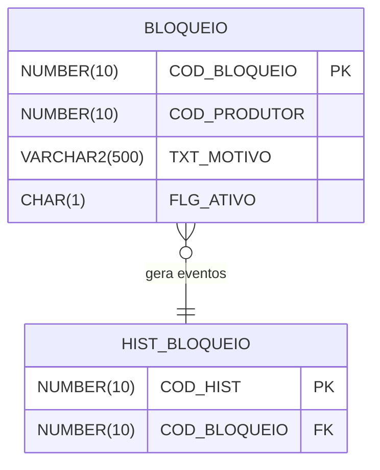

# Modelo de Dados — Bloqueios Sanitários

> **Derivado de:** REQUIREMENTS.md (RN-001, RN-002, RN-004)
> **Última atualização:** 20/09/2026

---

## 1. Diagrama Entidade-Relacionamento

---

## 2. Tabelas

### 2.1 BLOQUEIO

Tabela nova para bloqueios de produtores (RN-001, RN-002, RN-004).

**Identificação:** PK via sequence (nominal `SEQ_BLOQUEIO`)

| Coluna | Tipo | Obrigatório | PK/FK | Descrição |
|---|---|---|---|---|
| COD_BLOQUEIO | NUMBER(10) | Sim | PK | ID do bloqueio (sequence) |
| COD_PRODUTOR | NUMBER(10) | Sim | — | Produtor bloqueado |
| TXT_MOTIVO | VARCHAR2(500) | Sim | — | Motivo do bloqueio |
| FLG_ATIVO | CHAR(1) | Sim | — | S/N — bloqueio ativo |
| DTH_FIM | DATE | Não | — | Fim do bloqueio |
| TXT_MOTIVO_FIM | VARCHAR2(500) | Não | — | Motivo do encerramento |

**Check constraints:**
- `FLG_ATIVO IN ('S', 'N')`

### 2.2 HIST_BLOQUEIO

Tabela nova para histórico de eventos (RN-001, RN-004).

| Coluna | Tipo | Obrigatório | PK/FK | Descrição |
|---|---|---|---|---|
| COD_HIST | NUMBER(10) | Sim | PK | ID do evento (sequence) |
| COD_BLOQUEIO | NUMBER(10) | Sim | FK → BLOQUEIO | Bloqueio referenciado |
| TIP_EVENTO | VARCHAR2(20) | Sim | — | Tipo do evento |
| TXT_DETALHE | VARCHAR2(500) | Não | — | Detalhe do evento |

---

## 3. Decisão de armazenamento

| Opção | Status | Motivo |
|---|---|---|
| Criar `BLOQUEIO` e `HIST_BLOQUEIO` novas | **Adotado** | Sistema novo, sem tabelas legadas. |
