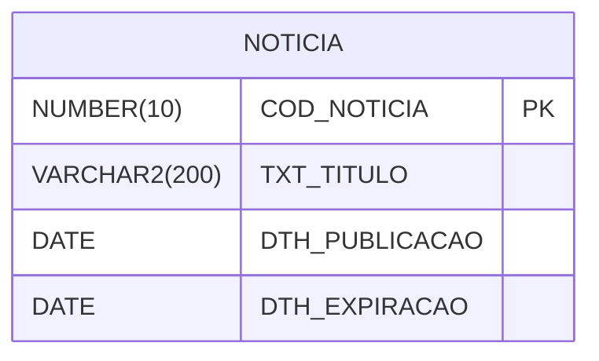

# Modelo de Dados — Portal de Notícias

> **Derivado de:** REQUIREMENTS.md (RN-001, RN-002)
> **Última atualização:** 12/10/2026

---

## 1. Diagrama Entidade-Relacionamento

---

## 2. Tabelas

### 2.1 NOTICIA

Tabela nova para notícias do portal (RN-001, RN-002).

| Coluna | Tipo | Obrigatório | PK/FK | Descrição |
|---|---|---|---|---|
| COD_NOTICIA | NUMBER(10) | Sim | PK | ID da notícia (sequence) |
| TXT_TITULO | VARCHAR2(200) | Sim | — | Título da notícia |
| DTH_PUBLICACAO | DATE | Sim | — | Data/hora da publicação |
| DTH_EXPIRACAO | DATE | Não | — | Data limite de exibição |

---

## 3. Decisão de armazenamento

| Opção | Status | Motivo |
|---|---|---|
| Criar NOTICIA nova | **Adotado** | Sistema novo, sem tabelas legadas. |
