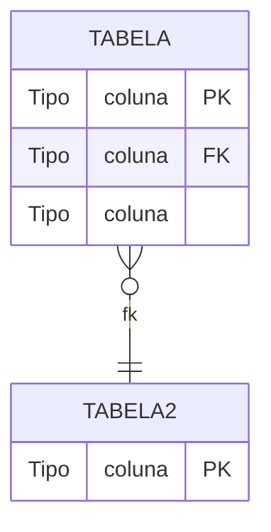

# rdd-data-model — Modelo de Dados (Tabelas e Relacionamentos)

Gera `<modulo>/<projeto>/specs/DATA_MODEL.md` com o modelo de dados focado em
**tabelas do banco** (não entidades ORM ou DTOs). Colunas, tipos de banco,
PKs, FKs, check constraints, índices e decisão de armazenamento.

## Resolução de caminhos (IMP-011)

Os artefatos do módulo seguem a estrutura com subpastas (IMP-011):

- **Raiz:** PROJECT_CHARTER.md, CONSTITUTION.md, REQUIREMENTS.md, DECISIONS.md, CHANGELOG.md
- **`specs/`:** DATA_MODEL.md, API_CONTRACTS.md, ERROR_CATALOG.md, UI_SPEC.md, ARCHITECTURE.md, SECURITY.md, ACCEPTANCE_CRITERIA.md, USER_STORIES.md, US<NNN>.md, FIGMA_PROMPTS.md, COMPLIANCE.md
- **`quality/`:** TEST_STRATEGY.md, DEFINITION_OF_DONE.md, TRACEABILITY.md, VALIDATION_REPORT.md, PROPAGATION_STATUS.md, PROGRESS_REPORT.md
- **`delivery/`:** TASKS.md, TASKS_*.md, TASKS_AZURE_CONSOLIDADO.md, SCOPE_AGREEMENT.md, CLIENT_REQUIREMENTS.md, CLIENT_REPORT_*.md, HANDOVER_LOG.md
- **`support/`:** LEGACY_CONTEXT.md, KNOWN_ERRORS.md, MIGRATION.md, CHANGE_REQUESTS.md
- **`glossaries/`:** DEV_GLOSSARY.md, BUSINESS_GLOSSARY.md, USER_GLOSSARY.md, GLOSSARY.md
- **`docs/`:** howto/*.md e documentos auxiliares
- **`meetings/`, `contracts/`:** checkpoints (inalterados)

**Regra de fallback (transição):** ao **LER** um artefato, verifique primeiro
o caminho novo (ex: `specs/DATA_MODEL.md`); se não existir, use o caminho
legado na raiz do módulo (ex: `DATA_MODEL.md`). Ao **ESCREVER/GERAR**, use
sempre o caminho novo. Módulos ainda não migrados via `rdd-restructure`
continuam legíveis durante a transição.

## Lê (upstream)

- `<modulo>/<projeto>/REQUIREMENTS.md` (essencial — §6 Dados e Campos, §9 Persistência e Auditoria)
- `<modulo>/<projeto>/DECISIONS.md` (se existir — decisões de armazenamento, ADRs)
- `<modulo>/<projeto>/support/LEGACY_CONTEXT.md` (essencial — tabelas, colunas e tipos do banco legado; fallback: raiz do módulo)
- `CONSTITUTION.md` (raiz do projeto — §13 Convenção de Banco de Dados: prefixo de tabelas, colunas de auditoria)

## Gera (downstream)

- `<modulo>/<projeto>/specs/DATA_MODEL.md`

## Nunca edita

- `REQUIREMENTS.md` (fonte primária não pode ser alterada por downstream)
- `DECISIONS.md`

## Tools

- `read` (ler REQUIREMENTS.md, DECISIONS.md, LEGACY_CONTEXT.md)
- `write` (escrever DATA_MODEL.md)
- `grep` (buscar padrões específicos nos documentos)
- `question` (para ambiguidades de tipo, nome de tabela, ou decisão de armazenamento)

## Modo de erro

`strict` — se o modelo de dados não for gerado, o fluxo de API contracts não pode prosseguir.
Se `LEGACY_CONTEXT.md` não existir e o módulo for `legado: true`, abortar (não é possível documentar tabelas legado sem o contexto).

## Propagação de confiança (legado)

- Afirmações derivadas de RN induzida de engenharia reversa **herdam a marca de confiança da RN de origem** (campo `**Confiança:**` em REQUIREMENTS.md).
- Escala: Alta → 🟢 CONFIRMADO · Média → 🟡 INFERIDO · Baixa → 🔴 GAP.
- **Regra de ouro:** na dúvida, nível mais baixo.
- Quando disponível, anexe a evidência da análise reversa (`[arquivo:linha]` ou `@<hash>`) — **afirmação sem evidência nunca recebe 🟢**.

## Formato de commit

```
docs: add data model for <projeto>
```

## Workflow

1. **CONSTITUTION.md §13 (Convenção de Banco de Dados)** — leia o prefixo obrigatório de tabelas (se houver), as colunas de auditoria exigidas (se houver) e o schema padrão. **Nomes de colunas sempre em MAIÚSCULAS.** Essas convenções estão documentadas na CONSTITUTION.md — o modelo de dados deve segui-las. Tabelas reaproveitadas do legado mantêm suas colunas originais.
2. **REQUIREMENTS.md §6 (Dados e Campos)** — extraia campos do formulário, tipos, obrigatoriedade
3. **REQUIREMENTS.md §9 (Persistência e Auditoria)** — extraia tabelas envolvidas, finalidade, rastreabilidade
4. **DECISIONS.md** — identifique ADRs sobre armazenamento (reuso de tabela existente vs criar nova)
5. **LEGACY_CONTEXT.md** — identifique tabelas legadas, colunas, tipos de banco (NUMBER, VARCHAR2, DATE), PKs, FKs, constraints, índices
6. Para cada tabela:
   - Se for **reaproveitada** (ex: `BLOQUEIO`): documentar TODAS as colunas da tabela legada, marcando as não usadas pelo módulo simplificado com "(não usado)"
   - Se for **nova**: derivar colunas de REQUIREMENTS.md §6 e tipos de banco apropriados. **Incluir colunas de auditoria conforme CONSTITUTION.md §13** (se exigidas). **Nomes de colunas sempre em MAIÚSCULAS.**
   - **As colunas de auditoria também devem constar no diagrama ER (mermaid) da §1** — não apenas na tabela de colunas da §2, para que fiquem visíveis na visão gráfica do modelo.
   - Documentar: nome real da tabela, PK, FKs, check constraints, índices
7. Para cada coluna de valor fixo (ex: `TP_BLOQUEIO_ACAO` com valores `1, 2`), documentar os valores no comentário da coluna
8. Criar tabela de **"Uso no módulo simplificado — colunas preenchidas"** mapeando campo do request → coluna da tabela
9. Se houver ADR conflitante (reuso vs tabela nova), resolver com `question` ou documentar a decisão final na seção "Decisão de armazenamento"
10. Escreva `specs/DATA_MODEL.md`

> **Regra de idioma:** Todos os documentos em português brasileiro (PT-BR). Títulos, descrições de colunas, comentários em PT-BR. Tipos de banco (`NUMBER`, `VARCHAR2`, `DATE`) e identificadores de coluna (`NRO_INT_BLOQUEIO`) mantêm o nome real do banco. **Nomes de colunas sempre em MAIÚSCULAS** (ex.: `CTR_DTH_INC`, `TXT_STATUS`).

## Template — DATA_MODEL.md

```yaml
---
project: <NOME>
module: modelo-dados
audience: [tecnica]
status: draft
---
```

```markdown
# Modelo de Dados — [Nome do Sistema]

> **Derivado de:** LEGACY_CONTEXT.md §3 (tabelas legado), REQUIREMENTS.md (RN-XXX, RN-YYY)
> **Última atualização:** DD/MM/AAAA

---

## 1. Diagrama Entidade-Relacionamento



- Tabelas externas marcadas como "apenas referência"

---

## 2. Tabelas

### 2.1 [NOME_DA_TABELA]

[Descrição: se é tabela existente reaproveitada ou nova, qual o critério de segregação]

**Identificação:** PK via sequence (nominal `SEQ_NOME` ou similar)

| Coluna | Tipo | Obrigatório | PK/FK | Descrição |
|---|---|---|---|---|
| NOME_COLUNA | NUMBER(10) | Sim | PK | ID (sequence) |
| NOME_COLUNA | VARCHAR2(100) | Sim | — | Descrição |
| NOME_COLUNA | NUMBER(5) | Não | FK → TABELA | Referência externa (não usado no simplificado) |
| CTR_DTH_INC | DATE | Sim | — | Data/hora de criação (auditoria) |
| CTR_DTH_ATU | DATE | Não | — | Data/hora da última atualização (auditoria) |
| CTR_USU_INC | NUMBER(8) | Sim | — | ID do usuário que criou (auditoria) |
| CTR_USU_ATU | NUMBER(8) | Não | — | ID do usuário da última atualização (auditoria) |
| CTR_NRO_IP_INC | VARCHAR2(15) | Sim | — | IP de origem da criação (auditoria) |
| CTR_NRO_IP_ATU | VARCHAR2(15) | Não | — | IP de origem da última atualização (auditoria) |
| ... | ... | ... | ... | ... |

**Check constraints:**
- `COLUNA IN (1, 2, 3)` — com descrição dos valores
- `CAMPO1 >= CAMPO2`

**Índices relevantes:**
- `IDX_NOME` (COLUNA)
- `IDX_NOME2` (COLUNA1, COLUNA2)

**Uso no módulo simplificado — colunas preenchidas:**

| Coluna | Valor | Origem |
|---|---|---|
| PK | Sequence | PK |
| CAMPO1 | Do request | Request |
| CAMPO2 | Valor fixo | Regra de negócio |
| ... | ... | ... |

---

### 2.2 [NOME_DA_TABELA2]

[Tabela catálogo, externa, etc.]

| Coluna | Tipo | Obrigatório | PK/FK | Descrição |
|---|---|---|---|---|
| PK | NUMBER(5) | Sim | PK | ID |
| NOME | VARCHAR2(100) | Sim | — | Nome |
| FLAG | CHAR(1) | Não | — | S/N — descrição |

**Relacionamentos:**
- 1:N com TABELA_PRINCIPAL (via FK)

---

## 3. Decisão de armazenamento

| Opção | Status | Motivo |
|---|---|---|
| Reutilizar `TABELA_LEGADA` com filtro | **Adotado** | Motivo da decisão. Ver ADR-NNN. |
| Criar `TABELA_NOVA` | Rejeitado | Motivo da rejeição. Ver ADR-MMM. |

Colunas marcadas como "não usado" podem ser nulas. O módulo simplificado só preenche as colunas indicadas na tabela de uso.
```

## Diferenças do template anterior

O formato anterior misturava três níveis — **tabela** (SDA_BLOQUEIO), **entidade JPA** (BloqueioProdutor com campos Java) e **DTO** (produtorNome). O novo formato documenta APENAS tabelas:

| O que mudou | Antes | Agora |
|---|---|---|
| Nomes | Entidade (Modelo) | Tabela real (ex: BLOQUEIO) |
| Tipos | Java (Long, LocalDate) | Banco (NUMBER, DATE) |
| Colunas não usadas | Omitidas | Listadas com "(não usado)" |
| Constraints | Apenas CK | CK + índices |
| Legado | Seção própria "Mapeamento Legado" | Removida (redundante com LEGACY_CONTEXT.md) |
| Value Objects (Enums) | No modelo | Removido (movido para API_CONTRACTS.md) |
| Decisão de armazenamento | Ausente | Nova seção §3 |
| Uso de colunas | Ausente | Tabela "Uso no módulo simplificado" |

## Casos de Borda

- **RN §6 sem campos suficientes para derivar a tabela**: complete com §9 (Persistência e Auditoria) e LEGACY_CONTEXT.md; o que restar ambíguo, pergunte via `question` — não invente coluna.
- **Tabela reaproveitada do LEGACY_CONTEXT.md**: documente TODAS as colunas legadas (marcando "(não usado)" as não usadas) e mantenha os tipos originais do banco — não aplique as convenções de tabela nova.
- **Tipo de coluna ambíguo** (ex: texto que pode ser VARCHAR2 ou NUMBER): pergunte via `question` antes de escrever; nunca derive tipo Java — só tipos de banco.
- **ADR conflitante (reuso vs tabela nova)**: registre as duas opções na seção de decisão de armazenamento e resolva com `question` ou documente a decisão final com referência ao ADR.
- **LEGACY_CONTEXT.md ausente em módulo `legado: true`**: aborte (modo `strict`) — não é possível documentar tabelas legado sem o contexto.
